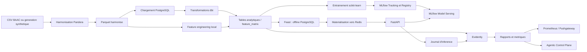
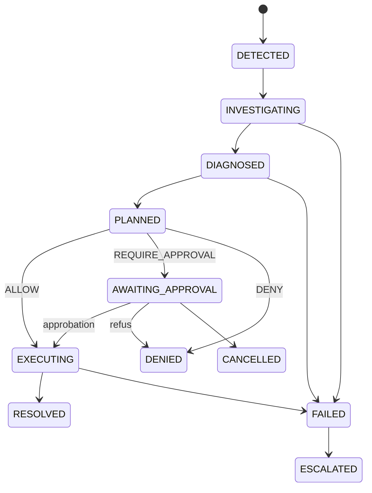

# BAAC MLOps — README

> **Le point d'entree de reference du depot.** Ce README explique le projet
> depuis son objectif metier jusqu'aux composants, aux donnees, aux commandes,
> aux tests et aux limites d'exploitation. Il decrit le code et les
> configurations presents dans ce depot ; il distingue explicitement les
> integrations operationnelles des simulations et des objectifs d'architecture.

Ce projet assemble un pipeline de donnees BAAC, un entrepot analytique, des
features, des modeles, un service d'inference et des mecanismes d'observabilite.
Un sous-projet distinct explore un **Agentic Control Plane** : il structure la
reponse aux signaux sous forme de contrats, de transitions controlees, de
decisions de politique et de preuves JSON. L'objectif de ce document est de
permettre a une personne qui decouvre le depot de comprendre non seulement
quels outils y figurent, mais aussi comment les pieces s'articulent, quelles
conditions sont necessaires pour les faire fonctionner et ou se situent les
limites actuelles.

## Demarrage rapide

### Prerequis minimaux

- Python 3.10 ou plus recent, conforme a [`pyproject.toml`](pyproject.toml) ;
- [`uv`](https://docs.astral.sh/uv/) pour l'environnement Python racine ;
- Docker avec Docker Compose pour les services locaux ;
- les outils DVC et dbt fournis par l'environnement du projet ;
- les donnees d'entree attendues, ou le generateur synthetique du depot.

### Installer et verifier l'environnement

Depuis la racine du depot :

```bash
uv sync
.venv/bin/pre-commit install
.venv/bin/pytest tests/test_data_contracts.py tests/test_api_serving.py -q
```

`make install` effectue l'installation et configure les hooks pre-commit.
L'installation des dependances ne demarre pas les services Docker et ne
materialise pas les donnees dans PostgreSQL ou Redis.

### Lancer une chaine locale de donnees

```bash
docker compose up -d
docker compose ps
PYTHONPATH=. .venv/bin/dvc repro
```

Apres avoir verifie que PostgreSQL local est pret et que la base cible est bien
une base de developpement, on peut charger les Parquet harmonises puis construire
l'entrepot :

```bash
PYTHONPATH=. .venv/bin/python scripts/load_to_postgres.py
cd dbt_warehouse && dbt build
```

**Attention :** le chargeur supprime avec `CASCADE` les tables brutes ciblees
avant de les recreer. Ne pas lancer cette etape sur une base partagee ou de
production sans sauvegarde et validation prealables.

### Essayer l'API et le plan de controle

Si le serving, le modele enregistre et les features en ligne ont ete prepares,
l'API est documentee par FastAPI a `http://localhost:8000/docs`. Le simple
demarrage de Docker ne garantit pas qu'un modele soit deja enregistre ni que
Redis contienne les features materialisees.

Pour une demonstration agentique locale :

```bash
cd agentic-control-plane
python demo.py DATA-042
pytest -v
```

Cette demonstration utilise un chemin local et un executor M0 simule ; elle
n'implique pas la creation d'un ticket distant ni un deploiement de modele.

### Choisir la bonne partie du README

- Pour comprendre le domaine et les couches : sections 1 a 4.
- Pour suivre les donnees jusqu'aux modeles : sections 5 a 9.
- Pour comprendre l'inference et la derive : sections 10 et 11.
- Pour les agents, la politique et l'evidence : section 12.
- Pour exploiter le depot, tester et depanner : sections 13 a 18.
- Pour les ecarts et hypotheses a ne pas oublier : section 19.

## Sommaire

1. [Vue d'ensemble](#1-vue-densemble)
2. [Vocabulaire et perimetre metier](#2-vocabulaire-et-perimetre-metier)
3. [Carte du depot](#3-carte-du-depot)
4. [Architecture generale](#4-architecture-generale)
5. [Cycle des donnees](#5-cycle-des-donnees)
6. [Contrats, harmonisation et qualite](#6-contrats-harmonisation-et-qualite)
7. [Entrepot et construction des variables](#7-entrepot-et-construction-des-variables)
8. [Feature store Feast](#8-feature-store-feast)
9. [Entrainement et registre MLflow](#9-entrainement-et-registre-mlflow)
10. [API d'inference](#10-api-dinference)
11. [Surveillance de la derive et boucle SRE](#11-surveillance-de-la-derive-et-boucle-sre)
12. [Agentic Control Plane et gouvernance](#12-agentic-control-plane-et-gouvernance)
13. [Infrastructure locale et services](#13-infrastructure-locale-et-services)
14. [Installation et premiers pas](#14-installation-et-premiers-pas)
15. [Commandes de travail](#15-commandes-de-travail)
16. [Tests, integration continue et conventions](#16-tests-integration-continue-et-conventions)
17. [Configuration, secrets et securite operationnelle](#17-configuration-secrets-et-securite-operationnelle)
18. [Depannage](#18-depannage)
19. [Limites connues et points a verifier](#19-limites-connues-et-points-a-verifier)
20. [Glossaire](#20-glossaire)
21. [Dossiers d'architecture et Bibles MLOps (`docs/`)](#21-dossiers-darchitecture-et-bibles-mlops-docs)

---

## 1. Vue d'ensemble

Ce depot met en place une plateforme de donnees et de machine learning autour
des donnees BAAC (Bulletin d'analyse des accidents corporels de la circulation).
Il regroupe plusieurs briques habituellement separees :

- preparation de donnees tabulaires et controle de leur schema ;
- chargement dans PostgreSQL et transformations analytiques dbt ;
- calcul de variables et definitions Feast ;
- entrainement et suivi de modeles avec scikit-learn et MLflow ;
- exposition d'une inference HTTP avec FastAPI ;
- suivi de derive et de qualite avec Evidently, Prefect et Prometheus ;
- demonstration d'un plan de controle agentique, avec propositions de
  remediation, decisions de politique et traces d'evidence ;
- quelques interfaces d'observation (Superset et Streamlit).

Le depot est donc a la fois un **prototype d'architecture MLOps**, un ensemble
de pipelines executables et une zone d'experimentation. Les composants ne
forment pas tous encore une chaine de production unique et completement
automatisee. En particulier, il faut distinguer les flux effectivement
raccordes dans le code des idees d'architecture presentees dans les documents.
Les distinctions et ecarts identifies sont notes dans les sections dediees.

### Objectifs fonctionnels

1. Importer des tables BAAC reliees par l'identifiant d'accident.
2. Harmoniser les variantes de structure et les valeurs manquantes.
3. Construire des tables analytiques et des variables de modelisation.
4. Enregistrer des executions et artefacts de modeles.
5. Servir une prediction de gravite pour un usager, a partir de variables
   disponibles dans le magasin en ligne.
6. Comparer les distributions de reference et d'observations recentes.
7. Produire des traces exploitables pour examiner et gouverner une remediation.

### Ce que le systeme ne garantit pas a lui seul

- Une prediction n'est pas une evaluation causale ni une decision de securite
  routiere.
- Une derive statistique ne prouve pas que la performance du modele a baisse.
- Une action proposee par un agent n'est pas necessairement executee ; la
  politique peut la refuser ou exiger un accord humain.
- Une configuration locale Docker ne constitue pas un deploiement de
  production durci.
- Les donnees presentes dans le repertoire de travail ne sont pas une garantie
  de disponibilite ou de provenance ; certaines peuvent etre generees pour les
  demonstrations.

## 2. Vocabulaire et perimetre metier

### Tables BAAC

Le pipeline travaille principalement avec quatre tables, portant chacune une
partie de l'information :

| Table | Contenu general | Cle de rattachement |
|---|---|---|
| `caracteristiques` | Date, heure, conditions et informations generales de l'accident | `num_acc` |
| `lieux` | Route, surface, situation et elements geographiques | `num_acc` |
| `vehicules` | Vehicules impliques et categories | `num_acc`, identifiant du vehicule |
| `usagers` | Personnes impliquees, categorie, equipement et gravite | `num_acc`, identifiant d'usager |

Les noms de colonnes et les champs presents varient selon les periodes et la
source. Le code convertit notamment les noms en minuscules pendant certains
chargements et traite des changements de structure comme l'eclatement de
`secu` en `secu1`, `secu2` et `secu3`. Le dictionnaire
[`config/value_dictionaries.yaml`](config/value_dictionaries.yaml) documente des
codes metier, leurs libelles et quelques ruptures historiques.

### Grain des donnees

- Une ligne de `caracteristiques` vise un accident.
- Une ligne de `lieux` vise un accident et le pipeline elimine les doublons
  `num_acc` en conservant la premiere ligne.
- Les tables `vehicules` et `usagers` sont plus detaillees : un accident peut
  comporter plusieurs vehicules et plusieurs usagers.
- La matrice construite par `FeatureEngineer` est au **grain usager** : elle
  part des usagers et leur rattache vehicule, lieu et caracteristiques
  d'accident par jointures gauche.

Ce grain a des consequences importantes : une jointure au grain accident peut
multiplier le nombre de lignes quand plusieurs usagers ou vehicules sont
associes a un accident. Les controles de cardinalite, les cles de jointure et
les comptages doivent donc etre interpretes en fonction du grain attendu.

### Cible de prediction

La famille A est configuree pour classifier `is_grave`, derivee de la gravite
de l'usager. La famille B est configuree pour predire `nb_accidents` et la
famille C est un pipeline hybride s'appuyant sur la famille A et un enrichissement
meteo. Le sens precis des classes, le seuil de gravite retenu et les usages
metier autorises doivent rester explicites dans toute utilisation aval : ils
ne se deduisent pas uniquement du nom du modele.

## 3. Carte du depot

| Chemin | Responsabilite |
|---|---|
| [`src/data/`](src/data/) | Contrats Pandera et harmonisation des tables source |
| [`src/features/`](src/features/) | Calcul local de variables et fonctions calendaires |
| [`src/models/`](src/models/) | Entrainement, surveillance et logique SRE liee aux modeles |
| [`src/warehouse/`](src/warehouse/) | Code de chargement / entrepot partage |
| [`app/`](app/) | API FastAPI, domaine, infrastructure et simulations Streamlit |
| [`app/api/`](app/api/) | Routes de donnees, executions et inference dans l'application |
| [`scripts/`](scripts/) | Entrees de commandes pour generation, chargement, pipeline et batchs |
| [`flows/`](flows/) | Flows Prefect supplementaires |
| [`dbt_warehouse/`](dbt_warehouse/) | Projet dbt : staging, intermediate, marts et tests SQL |
| [`feature_repo/`](feature_repo/) | Definitions Feast, source hors ligne et configuration |
| [`agentic-control-plane/`](agentic-control-plane/) | Core, runtime, adaptateurs, outils, gouvernance et demos agentiques |
| [`config/`](config/) | Dictionnaires de valeurs et lineage de colonnes |
| [`data/`](data/) | Donnees locales brutes, harmonisees et matrice de variables |
| [`reports/`](reports/) | Rapports et exports de metriques de derive |
| [`tests/`](tests/) | Tests racine de contrats et de l'API de serving |
| [`docker-compose.yml`](docker-compose.yml) | Services locaux pour bases, registre, monitoring et serving |
| [`dvc.yaml`](dvc.yaml) | DAG DVC de generation et harmonisation |
| [`Makefile`](Makefile) | Raccourcis de developpement et d'exploitation locale |
| [`pyproject.toml`](pyproject.toml) | Dependances et metadonnees Python du depot racine |
| [`.github/workflows/mlops-ci.yml`](.github/workflows/mlops-ci.yml) | Tests CI et construction de l'image API |

Le sous-projet `agentic-control-plane` dispose de son propre `requirements.txt`
et de ses propres tests. Il ne faut pas le confondre avec l'API FastAPI racine :
il s'agit d'une couche d'orchestration et de gouvernance, avec ses adaptateurs
et ses exemples.

## 4. Architecture generale

### Vue logique



Le diagramme represente le flux cible et les integrations presentes dans le
depot. Il n'implique pas que chaque fleche soit automatiquement declenchee dans
un environnement vierge. Par exemple, la materialisation Feast, la presence du
modele enregistre et la disponibilite des donnees de reference sont des
preconditions d'une prediction reelle.

### Couches et responsabilites

1. **Ingestion** : fichiers CSV locaux et script de generation synthetique.
2. **Qualite et standardisation** : nettoyage des cles, valeurs et schemas,
   puis ecriture en Parquet.
3. **Stockage analytique** : PostgreSQL pour les tables chargees et les sorties
   dbt ; Parquet pour des artefacts locaux de donnees.
4. **Feature engineering** : agregation et derives au grain usager.
5. **Machine learning** : apprentissage, mesures, tracking et stockage des
   artefacts.
6. **Serving** : API, lecture Feast en ligne et appel du serveur de modele.
7. **Observabilite** : comparaison reference / production, rapports, metriques
   et simulations SRE.
8. **Gouvernance agentique** : interpretation d'un signal, proposition
   structuree, application d'une politique et persistance d'evidence.

## 5. Cycle des donnees

### 5.1 Generation ou acquisition

[`scripts/generate_synthetic_baac.py`](scripts/generate_synthetic_baac.py)
produit des tables synthetiques et ecrit les CSV sous `data/raw/`. Ce script
est l'etape `generate_data` du pipeline DVC. Les donnees synthetiques sont
utiles pour les tests et demonstrations reproductibles, mais ne doivent pas
etre presentees comme des observations officielles.

Le depot inclut aussi des donnees locales sous `data/raw/` et des sorties
Parquet dans `data/harmonized/` et `data/features/`. La presence de ces
fichiers dans une copie de travail ne garantit pas qu'ils soient regenerables
sans executer les prerequis, ni qu'ils correspondent a la derniere version du
code.

### 5.2 Harmonisation

[`src/data/harmonizer.py`](src/data/harmonizer.py) traite chaque table trouvee
dans `data/raw/`, puis ecrit un Parquet correspondant dans `data/harmonized/`.
Le traitement visible dans le code comporte notamment :

- lecture defensive des CSV en chaine de caracteres et detection du separateur ;
- normalisation des noms de colonnes ;
- normalisation de `num_acc` et remplissage a gauche de la cle ;
- suppression des accidents sans cle et dedoublonnage de `lieux` ;
- normalisation de formats tels que l'heure ;
- adaptation de certains changements de colonnes et champs geographiques ;
- unification des valeurs manquantes ;
- validation des donnees et ecriture Parquet.

L'ordre exact des traitements est dans `BAACHarmonizer.run_full_pipeline`.
Si une table attendue est absente, le code journalise un avertissement et la
saute ; il ne faut donc pas assimiler une execution terminee a une validation
complete du jeu de donnees.

### 5.3 Reproductibilite avec DVC

[`dvc.yaml`](dvc.yaml) declare deux etapes :

1. `generate_data` execute le generateur et suit quatre CSV bruts comme sorties ;
2. `harmonize` depend du code d'harmonisation, des contrats, du dictionnaire et
   des quatre CSV, puis produit quatre Parquet harmonises.

La commande `dvc repro` calcule les dependances et peut reutiliser le cache
DVC. Le graphe DVC ne declare pas a lui seul le chargement PostgreSQL, dbt,
l'entrainement ou le materialize Feast : ceux-ci sont orchestres separement par
le script de pipeline principal et les commandes du Makefile.

### 5.4 Chargement PostgreSQL

[`scripts/load_to_postgres.py`](scripts/load_to_postgres.py) lit les Parquet
harmonises, met les noms de colonnes en minuscules et ecrit les tables :

- `raw_caracteristiques` ;
- `raw_lieux` ;
- `raw_vehicules` ;
- `raw_usagers`.

Avant chaque chargement, le script supprime la table cible avec `CASCADE`, puis
la recree. C'est une operation destructive pour les tables concernees et les
objets qui en dependent. Ne lancez pas ce chargement sur une base partagee ou
de production sans verifier le schema, les sauvegardes et l'impact.

### 5.5 Orchestration globale declaree

[`scripts/run_pipeline.py`](scripts/run_pipeline.py) expose un flow Prefect qui
execute en serie :

1. `dvc repro` ;
2. chargement PostgreSQL ;
3. `dbt build` ;
4. entrainement des familles A, B et C ;
5. batch d'explicabilite SHAP ;
6. batch d'agregation geographique.

Les appels aux scripts utilisent le Python du processus Prefect ; l'etape DVC
cherche explicitement `.venv/bin/dvc`, alors que dbt est invoque sous le nom
`dbt` dans l'environnement actif. Il faut donc que ces executables et les
variables d'environnement necessaires soient disponibles. Le code de ce flow
ne lance pas explicitement toutes les etapes de l'architecture generale :
notamment, le flux drift et le `feast materialize` doivent etre demarres ou
configures separement.

## 6. Contrats, harmonisation et qualite

### Contrats Pandera

[`src/data/contracts.py`](src/data/contracts.py) definit des modeles Pandera
pour les quatre familles de tables. Les schemas controlent des exemples de
contraintes telles que :

- unicite et presence de certaines cles ;
- domaines numeriques (annees, mois, jours, latitudes et longitudes) ;
- valeurs autorisees pour l'eclairage, la gravite ou la categorie d'usager ;
- coercition des types et schema non strict (`strict = False`).

La validation est une barriere de qualite a l'execution, pas une preuve de
completude ou de justesse metier. Les contraintes doivent rester compatibles
avec la periode des donnees et les changements de definition historique.

Les tests [`tests/test_data_contracts.py`](tests/test_data_contracts.py)
verifient des exemples valides et des rejets de valeurs aberrantes pour
l'usager. D'autres schemas peuvent avoir des regles differentes ; ne generalisez
pas les assertions d'un seul schema a toutes les tables.

### Dictionnaire de valeurs et changements historiques

[`config/value_dictionaries.yaml`](config/value_dictionaries.yaml) sert de
referentiel documentaire de codes BAAC. Il contient, entre autres, les valeurs
admises pour l'eclairage, la route, la surface, le vehicule, la gravite et le
motif du deplacement. Il indique aussi des ruptures telles que :

- une evolution de l'interpretation de la gravite a partir de 2018 ;
- l'ajout de categories de vehicules ;
- la transformation de la colonne d'equipement de securite a partir de 2023.

Ces ruptures signifient qu'une meme valeur codee peut ne pas representer une
meme realite dans toutes les periodes. Une comparaison temporelle necessite
donc une strategie d'harmonisation explicite. Le dictionnaire seul ne garantit
pas que toutes les transformations sont appliquees a chaque pipeline.

### Lineage

[`config/column_lineage.yaml`](config/column_lineage.yaml) documente la filiation
de colonnes. Lors de l'ajout d'une variable, garder le lineage synchronise aide
a retracer sa source et ses transformations, en particulier quand une feature
est consommee a la fois par dbt, Feast et le serving.

## 7. Entrepot et construction des variables

### Documents de reference et bibles d'architecture (`docs/`)

Pour approfondir la conception analytique et les choix d'ingenierie, deux documents fondateurs sont consultables sous `docs/` :

- [`docs/data_warehouse_genesis.md`](docs/data_warehouse_genesis.md) (**Genese du Data Warehouse MLOps**) :
  Boussole architecturale expliquant pourquoi l'entrepot est concu comme un sous-produit essentiel du monitoring en production. Details de la defense d'architecture :
  - **Grain mismatch** : distinction entre le grain macroscopique « Accident » (comptages BI, KPIs) et le grain d'entrainement fin « Usager » (mesure de gravite) pour eviter les duplications artificielles par explosion combinatoire ;
  - **Schema en etoile strict versus Flocon** : refus de la sur-normalisation inutile ;
  - **`PostgreSQL` versus Lakehouse** : justification du rejet d'une stack lourde `MinIO` + `Apache Iceberg` + `Trino` pour un volume annuel maitrise (~100 Mo).
- [`docs/bible_warehouse.md`](docs/bible_warehouse.md) (**Bible des Mega Copier-Coller Warehouse**) :
  Referentiel exhaustif (1800+ lignes) formalisant le mapping vivant entre les concepts Data Warehouse classiques et les briques MLOps du projet (ingestion, `dbt`, Feature Store `Feast`, monitoring). Details des 6 cas d'usage metier BAAC et de la modelisation des tables de faits (`fact_accident`, `fact_accident_usager`) et des dimensions (`dim_lieu`, `dim_usager`, `dim_vehicule`, `dim_conditions`).

### dbt

Le projet dbt est dans `dbt_warehouse/`. La configuration place les modeles en
trois couches :

- **staging** : vues `stg_*` qui exposent et normalisent les sources brutes ;
- **intermediate** : vues qui joignent les donnees et construisent des groupes
  de variables ;
- **marts** : tables de dimensions, faits et matrice de variables.

Les modeles SQL visibles incluent notamment `int_accidents_joined`,
`int_features_lieux`, `int_features_temporelles`, `fact_accident`,
`fact_accident_usager`, des dimensions et `feature_matrix`. `dbt build` execute
les modeles et tests dbt declares. Les fichiers `schema.yml` apportent des tests
de schema ; `tests/no_future_dates.sql` contient un test SQL personnalise.

Le profil de developpement `dbt_warehouse/profiles.yml` cible PostgreSQL local.
Le fichier contient des parametres de developpement ; il faut les externaliser
et les securiser avant tout usage partage.

### Feature engineering Python

[`src/features/build_features.py`](src/features/build_features.py) expose
`FeatureEngineer`. Il charge les quatre Parquet harmonises, met les colonnes
en minuscules, puis joint les tables au grain usager. Le traitement est organise
en familles de variables, notamment :

- age et tranche d'age ;
- attributs de vehicule et de mobilite ;
- heure, periode et calendrier ;
- resume des conditions meteo ;
- signaux temporels et de localisation ;
- indicateurs de risque de zone et caracteristiques d'infrastructure ;
- variables disponibles au temps d'inference (T0) ;
- cible et horodatage Feast.

Les jointures sont des jointures gauches : un usager reste dans la table meme
si une information de lieu, de caracteristiques ou de vehicule manque. En
contrepartie, des colonnes peuvent rester nulles et leur politique de traitement
doit etre coherente entre entrainement et inference.

Le code contient des fonctions calendaires dans
[`src/features/calendar_utils.py`](src/features/calendar_utils.py). Les
parametres, dates de reference et dependances d'une feature doivent etre
verifies avant de comparer des entrainements de periodes differentes.

### Deux chemins de construction

Le depot contient a la fois des transformations SQL dbt et un constructeur
Python de matrice de features. Ces implementations ne sont pas automatiquement
interchangeables. Avant de traiter l'une comme source de verite unique, comparer :

1. la liste et le type des colonnes en sortie ;
2. le grain et les cles ;
3. les formules, valeurs manquantes et dates de reference ;
4. la cible, ses regles de calcul et les risques de fuite de cible ;
5. la compatibilite avec le schema Feast et le payload d'inference.

## 8. Feature store Feast

[`feature_repo/feature_repo/features.py`](feature_repo/feature_repo/features.py)
declare l'entite `usager`, dont la cle de jointure est `usager_id`, et la vue
`usagers_features`. La source hors ligne est une requete PostgreSQL sur
`feature_matrix`, avec `event_timestamp` comme horodatage. La vue inclut des
variables demographiques, de trajet, de contexte et de risque ; elle est
marquee `online=True`.

[`feature_repo/feature_repo/feature_store.yaml`](feature_repo/feature_repo/feature_store.yaml)
configure :

- un registre local sous `data/registry.db` ;
- PostgreSQL comme magasin hors ligne ;
- Redis comme magasin en ligne.

Les adresses et parametres du fichier sont orientes developpement local. Dans
Docker, le `Dockerfile.api` remplace certaines references `localhost` lors de
la construction de l'image. Le serving depend de donnees materialisees dans
Redis ; declarer une FeatureView n'y insere pas automatiquement les valeurs.
Les commandes exactes de materialisation doivent etre executees en coherence
avec les tables et timestamps disponibles.

**Point de vigilance :** les noms et types de champs de la FeatureView doivent
etre alignes avec la matrice construite, le code de formation et la liste de
features attendue par `app/main.py`. Toute evolution doit etre testee de bout en
bout, et pas seulement validee par la configuration Feast.

## 9. Entrainement et registre MLflow

### Familles configurees

[`src/models/train_famille.py`](src/models/train_famille.py) contient une usine
de modeles :

| Famille | Intention configuree | Type | Cible configuree |
|---|---|---|---|
| A | Classification de gravite | Classifieur Random Forest | `is_grave` |
| B | Prevision temporelle | Regresseur Random Forest | `nb_accidents` |
| C | Pipeline hybride enrichi par une information meteo | `mlflow.pyfunc` enveloppant A | Prediction de A |

La classe `ModelFactory` configure l'experience MLflow, l'URI de tracking et
Feast. Les familles A et B recuperent des features historiques pour entrainer
un modele ; la famille C enregistre un wrapper hybride. La configuration inclut
des metriques de classification ou de regression selon le cas.

La famille C peut appeler l'API d'archive Open-Meteo lorsque le payload fournit
latitude, longitude et horodatage. Les erreurs ou reponses non valides
declenchent un libelle de repli dans le code du wrapper. Ce comportement implique
une dependance reseau au moment de prediction et doit etre pris en compte pour
la latence, la reproductibilite et la disponibilite.

### MLflow et objets

Le compose local distingue :

- le serveur MLflow, dont le port interne 5000 est publie sur le port hote
  5001 ;
- MinIO pour les artefacts compatibles S3 ;
- un conteneur distinct de serving MLflow, expose sur le port hote 5002.

Le point d'entree d'entrainement, ses variables d'environnement et les URI
configures dans le code doivent concorder avec ces ports. Apres entrainement,
verifier dans MLflow que l'experience, le run, les metriques, l'artefact et la
version enregistree existent avant d'attendre que l'API puisse charger le modele.

### Reproductibilite et evaluation

La presence d'un modele dans le registre n'est pas a elle seule un critere de
promotion. Il faut pouvoir retrouver les donnees, la version de code, les
parametres, la periode d'entrainement, les metriques et les tests de validation.
Les decoupages train/test, la gestion du desequilibre de classes et les seuils
operationnels doivent etre relus dans le code de chaque famille avant tout
usage decisionnel.

## 10. API d'inference

L'application de serving principale est [`app/main.py`](app/main.py). Elle
expose une API FastAPI et utilise Feast pour rechercher les variables en ligne,
puis envoie un payload au serveur MLflow.

### Flux de `/predict/{famille}/{usager_id}`

1. La route met le nom de famille en majuscules et n'accepte actuellement que
   la famille A en mode reel.
2. Elle verifie que le client Feast a ete initialise.
3. Elle demande a Redis la liste de features configuree pour `usager_id`.
4. Elle transforme le resultat en DataFrame, enleve la cle d'entite et normalise
   les noms de colonnes.
5. Elle verifie que les features ne sont pas toutes nulles.
6. Elle aligne les colonnes sur l'ordre attendu par le modele.
7. Les features absentes sont actuellement remplacees par zero.
8. Elle appelle `MLFLOW_SERVE_URL`, puis extrait la premiere prediction.
9. Elle tente d'ecrire une ligne dans PostgreSQL ; en cas d'echec, elle ecrit
   dans un CSV de repli local.
10. Elle renvoie l'identifiant d'usager, la classe predite, une etiquette de
    version et la source des features.

La route racine retourne un message de disponibilite et FastAPI fournit sa
documentation interactive sous `/docs`. Les tests de l'API mockent Feast, le
serveur MLflow et l'ecriture SQL ; ils valident donc le contrat de route sans
necessiter ces dependances operationnelles.

### Interpretations importantes

- La version renvoyee est actuellement une etiquette statique (`latest`) ;
  elle ne prouve pas quelle version precise a effectivement servi la requete.
- Le remplacement silencieux d'une feature absente par zero peut masquer une
  incompatibilite entre le schema Feast et le modele. A traiter explicitement
  avant une mise en production.
- Une exception de lecture Feast ou d'inference devient une reponse HTTP 500 ;
  l'absence de donnees peut produire un 404 dans le chemin prevu.
- Le journal de repli CSV et le journal PostgreSQL n'ont pas necessairement la
  meme destination ou le meme cycle de vie.
- Le modele renvoie une classe ; cette reponse ne doit pas etre interpretee
  comme une recommandation medicale, legale ou administrative.

Les autres routes sous `app/api/` correspondent a un domaine d'execution et de
gestion de datasets. Elles sont distinctes du endpoint de prediction implemente
dans `app/main.py` ; verifier les routeurs inclus dans chaque application avant
de supposer qu'elles sont accessibles au meme serveur.

## 11. Surveillance de la derive et boucle SRE

### Job Evidently

[`scripts/run_drift_analysis.py`](scripts/run_drift_analysis.py) declare un
flow Prefect qui :

1. charge la reference depuis `data/features/feature_matrix.parquet` ;
2. charge le journal `data/production_logs/shadow_log.csv`, s'il existe ;
3. refuse de lancer la comparaison si le journal comporte moins de 30 lignes ;
4. selectionne les features connues des deux jeux et harmonise leur type ;
5. produit un rapport HTML de derive et de qualite Evidently ;
6. produit une suite de tests HTML ;
7. extrait une proportion de colonnes detectees en derive ;
8. ecrit des metriques Prometheus dans un fichier et tente un Pushgateway ;
9. peut declencher une action du moteur SRE si le seuil critique est franchi.

Les seuils configures dans le script sont de 15 % pour le niveau avertissement
et de 30 % pour l'alerte critique. Le resultat est une mesure statistique des
distributions sur les colonnes communes ; il ne mesure pas directement la
qualite des etiquettes ni la precision des predictions.

Les rapports sont ecrits sous `reports/drift/`. Les noms de fichiers incluent
un horodatage. Les metriques exposent la part de derive et des scores par
feature. Prometheus est configure dans [`prometheus.yml`](prometheus.yml) pour
scraper une cible API et le Pushgateway ; l'integration effective depend de la
disponibilite des services et du mode de lancement.

### Compatibilite du journal

L'API racine ecrit normalement le shadow log dans PostgreSQL, avec un CSV de
repli nomme `shadow_log_fallback.csv`. Le job Evidently lit, lui,
`data/production_logs/shadow_log.csv`. Le simulateur de derive
[`simulate_drift.py`](simulate_drift.py) et certains adaptateurs peuvent aussi
viser `shadow_log.csv`.

Il existe donc plusieurs chemins d'observation. Pour analyser de vraies
requêtes, verifier que les donnees sont effectivement exportees vers le fichier
lu par Evidently et que les noms de colonnes correspondent aux features de
reference. Un echec de correspondance peut reduire le nombre de variables
comparees ou conduire a l'absence de comparaison.

### Moteur SRE et simulations

Le depot contient `src/models/sre_engine.py`, des scripts de simulation, ainsi
que des workflows dans `app/workflows/`. Ces elements demontrent des reactions
possibles a des cas de derive, d'infrastructure ou de collapse de modele. Ils
ne doivent pas etre confondus avec une action de retrain/deploiement securisee
et generalisee. Verifier les effets, les chemins de donnees et la politique
avant d'executer une simulation qui ecrit des fichiers ou modifie une base.

### Documents de reference : Data Observability et propagation des defaillances (`docs/`)

- [`docs/bi_observability_genesis.md`](docs/bi_observability_genesis.md) (**Genese de la Data Observability**) :
  Analyse comparative et justification du choix d'**Apache Superset** face a `Grafana` et `Metabase` pour la couche de restitution analytique : capacites SQL Lab « SQL-first » pour data engineers, requetage de jointures complexes sur l'entrepot `dbt`/`PostgreSQL`, et cartographie geographique des points chauds d'accidents (heatmaps lat/long).
- [`docs/mlops_failure_propagation_graph.md`](docs/mlops_failure_propagation_graph.md) (**Graphe de propagation des defaillances MLOps**) :
  Modelisation causale de l'effet domino a travers les couches de la stack. Identifie les 7 sources racines (`Infra`, `Data`, `Features`, `Temps`, `Training`, `Securite`, `Humain`), les 3 modes de propagation (cascade technique bruyante, cascade silencieuse destructrice de valeur metier, cascade temporelle retardee), la *Silent Failure Factory* a l'intersection `Feature + Temps + Data`, et la criticite d'une defaillance du sous-systeme d'observabilite.

## 12. Agentic Control Plane et gouvernance

Le sous-projet [`agentic-control-plane/`](agentic-control-plane/) separe la
logique centrale des integrations concretes.

### Principe de conception

Le principe affiche par le projet est : **le modele propose ; du code
deterministe valide, autorise et execute**. Le Core manipule des contrats
typiques (risque, signal, diagnostic, proposition d'action, decision, resultat,
episode) sans dependance directe a Evidently, MLflow, PostgreSQL, GitHub ou
Prefect. Les adaptateurs relient les contrats aux sources concretes.

### Composants

- `agentic/core/contracts.py` : schemas Pydantic des objets et enums d'action.
- `agentic/core/state.py` : machine a etats et transitions autorisees.
- `agentic/core/policy.py` : evaluation deterministe de la politique YAML.
- `agentic/core/evidence.py` : ecriture d'episodes JSON et index de deduplication.
- `agentic/core/idempotency.py` : cle SHA-256 derivée du risque, de la source,
  de l'environnement et de la fenetre temporelle.
- `agentic/runtime/` : orchestration, specialistes, planification et execution.
- `agentic/adapters/` : sources BAAC, fake, MLflow et infrastructure.
- `agentic/tools/` : abstractions et capacites de donnees, modele,
  observabilite, infrastructure et GitHub.
- `governance/` : registre des risques et politique d'autonomie.
- `schemas/` : schemas JSON pour contrats de risque, action, diagnostic et evidence.
- `tests/` : tests de la politique, de l'etat, de l'idempotence et des limites
  d'architecture, ainsi que des scenarios de chaos.

### Cycle d'un episode



La machine est definie dans `agentic/core/state.py`. L'orchestrateur construit
une trace d'etats, obtient le signal, demande un diagnostic, planifie une
action, l'evalue par la politique et enregistre un episode.

### Decisions de politique

[`agentic-control-plane/governance/autonomy_policy.yaml`](agentic-control-plane/governance/autonomy_policy.yaml)
associe des niveaux d'autonomie a plusieurs types d'action :

- certaines actions d'investigation, de creation de ticket et de proposition
  d'entrainement sont configurables comme autonomes ;
- des actions a impact plus eleve, comme deployer ou entrainer effectivement,
  exigent une approbation humaine ;
- l'action `create_issue` comporte une limite de blast radius ;
- toute action sans regle correspondante est refusee par le PolicyEngine.

La decision de la politique ne garantit pas que l'effet externe se produise.
L'executor de M0 est explicitement simule : une creation de ticket renvoie une
reference locale fictive ; certaines actions sont des no-op ; les autres sont
indiquees comme non supportees. Ne pas traiter cette execution comme une
integration reelle avec GitHub ou un orchestrateur de deploiement.

### Specialistes et appels LLM

Le depot contient des specialistes et un agent de remediation bases sur
Instructor et LiteLLM, ainsi que des voies simulables et des adaptateurs fake.
Les propositions sont converties vers des contrats Pydantic et les champs
critiques sont reassignes par le code d'orchestration. Cette validation de
structure ne transforme pas le contenu du diagnostic en fait verifie : les
evidences sources et les regles de politique restent indispensables.

La disponibilite d'une cle de fournisseur, du modele LLM ou d'un acces reseau
depend du chemin execute. Pour un test deterministic, utiliser les adaptateurs
et scenarios prevus a cet effet et verifier si le test implique un appel LLM.

### Idempotence et evidence : nuance importante

La cle de deduplication est calculee et l'index permet de retrouver un episode
associe. Dans l'orchestrateur actuel, la detection d'un episode existant imprime
un message, mais le code continue ensuite a creer un nouvel episode ; ce test
ne constitue donc pas a lui seul une garantie d'arret idempotent.
L'evidence est un JSON local, et l'index un fichier local : ce n'est ni un
journal distribue transactionnel, ni une garantie cryptographique de non-
repudiation. Plusieurs chemins de demo peuvent utiliser des repertoires
d'evidence differents.

### Entrees de demonstration

- [`agentic-control-plane/demo.py`](agentic-control-plane/demo.py) : demo en
  ligne de commande et substitution d'adaptateur.
- `agentic/entrypoints/prefect_app.py` : flow Prefect qui route les risques vers
  des adaptateurs puis appelle l'orchestrateur.
- `scripts/demo_prefect_flow.py` : autre demonstration Prefect mentionnee par
  les documents du projet.

Le premier est le chemin le plus simple pour explorer les contrats et la
politique. Le flow Prefect a ses propres hypotheses d'environnement, de
disponibilite des adaptateurs et de fournisseur LLM.

## 13. Infrastructure locale et services

[`docker-compose.yml`](docker-compose.yml) declare les services suivants :

| Service | Fonction | Port hote declare |
|---|---|---:|
| `db` | PostgreSQL pour stockage et transformations | 5432 |
| `minio` | Stockage objet compatible S3 et console | 9000, 9001 |
| `mlflow` | Tracking / registry MLflow | 5001 vers 5000 interne |
| `mlflow-serve` | Endpoint d'inference MLflow | 5002 |
| `redis` | Store en ligne Feast | 6379 |
| `prometheus` | Collecte de metriques | 9090 |
| `pushgateway` | Reception de metriques de jobs batch | 9091 |
| `fastapi-serving` | API de prediction | 8000 |
| `superset` | Exploration et tableaux de bord | 8088 |

Des volumes Docker sont declares pour conserver PostgreSQL et MinIO entre les
redemarrages. Les commandes d'arret ne suppriment pas necessairement ces
volumes ; a l'inverse, leur suppression efface les donnees persistantes.

### Superset, MLflow et Streamlit

- Superset est initialise par [`superset-init.sh`](superset-init.sh) et utilise
  la configuration sous `superset_config/`.
- MLflow fournit l'interface de tracking et le registre.
- [`app/dashboard.py`](app/dashboard.py) est un tableau Streamlit qui lit les
  fichiers JSON d'evidence dans `agentic-control-plane/evidence/`.

Le tableau Streamlit suppose que les fichiers existent au chemin relatif depuis
le repertoire courant. Il ne lit pas un backend distant et n'est donc pas un
service d'audit partage a lui seul.

## 14. Installation et premiers pas

### Prerequis

- Python compatible avec `pyproject.toml` (Python 3.10 ou plus recent) ;
- `uv` pour synchroniser l'environnement racine ;
- Docker avec le plugin `docker compose` ;
- DVC et dbt installes dans l'environnement de developpement ;
- acces aux dependances externes si un chemin appelle un fournisseur ou une API.

### Installer le depot racine

Depuis la racine :

```bash
uv sync
.venv/bin/pre-commit install
```

Equivalent raccourci :

```bash
make install
```

Le sous-projet agentique peut avoir son environnement Python independant ;
consulter son `README.md` et `requirements.txt` avant de reutiliser
l'environnement racine.

### Demarrer les services locaux

```bash
docker compose up -d
docker compose ps
```

Verifier l'etat de sante des conteneurs, les ports publies et les journaux.
L'API, les modeles enregistres, les donnees de Feast et les dashboards ne sont
pas necessairement tous prets des que la commande Docker retourne.

### Executer le pipeline de donnees

```bash
PYTHONPATH=. .venv/bin/dvc repro
```

Puis, apres verification des fichiers produits et de la base cible :

```bash
PYTHONPATH=. .venv/bin/python scripts/load_to_postgres.py
cd dbt_warehouse && dbt build
```

Le chargement SQL remplace les tables brutes existantes. Se reporter aux
avertissements de la section [cycle des donnees](#5-cycle-des-donnees).

### Explorer le control plane

Dans un environnement avec les dependances agentiques installees :

```bash
cd agentic-control-plane
python demo.py DATA-042
pytest -v
```

Inspecter les episodes crees et distinguer les sorties simulees des integrations
reelles.

## 15. Commandes de travail

Les cibles Makefile documentees dans [`Makefile`](Makefile) comprennent :

```bash
make help
make infra-up
make infra-down
make data-repro
make dbt-run
make features
make train
make serve
make drift
make batch-shap
make batch-zones
make pipeline
```

Resume des cibles :

| Cible | Effet |
|---|---|
| `infra-up` / `infra-down` | Demarre ou arrete les conteneurs |
| `data-repro` | Rejoue le pipeline DVC |
| `dbt-run` | Execute `dbt build` dans le projet dbt |
| `features` | Execute `feast apply` dans `feature_repo/` |
| `train` | Lance l'entrainement configure et les parametres MinIO |
| `serve` | Lance Uvicorn avec rechargement sur le port 8000 |
| `drift` | Lance l'analyse Evidently |
| `batch-shap` | Execute le batch SHAP |
| `batch-zones` | Execute le batch d'agregation geographique |
| `pipeline` | Lance le flow Prefect global declare dans `scripts/run_pipeline.py` |

Une cible Makefile est un raccourci, pas une verification que toutes les
dependances de la cible sont pretes. Pour debugger, lancer d'abord les etapes
individuellement et examiner leur code retour et leurs sorties.

### Interfaces locales

Les ports declares par Compose sont listes a la section
[infrastructure](#13-infrastructure-locale-et-services). En particulier,
l'interface de tracking MLflow est publiee sur le port hote **5001** dans la
configuration actuelle, tandis que le port 5000 est son port interne au
conteneur. Le serveur MLflow d'inference est expose sur 5002.

L'API s'ouvre sur `http://localhost:8000/docs` lorsque le service est lance.
Le dashboard Streamlit peut etre lance avec :

```bash
.venv/bin/streamlit run app/dashboard.py
```

## 16. Tests, integration continue et conventions

### Tests locaux

Tests racine :

```bash
.venv/bin/pytest tests/test_data_contracts.py tests/test_api_serving.py -q
```

Tests agentiques, depuis le sous-projet :

```bash
cd agentic-control-plane
pytest -v
```

Les tests API utilisent des mocks pour le Feature Store, MLflow et l'ecriture
dans PostgreSQL. Ils valident un chemin fonctionnel mais ne remplacent pas un
test d'integration avec les conteneurs et les vraies donnees.

### CI

Le workflow [.github/workflows/mlops-ci.yml](.github/workflows/mlops-ci.yml)
execute les tests de contrats et de serving, puis construit une image Docker
sur les pushes de la branche principale. L'etape de publication est explicitement
simulee par une commande d'echo ; ce workflow ne publie donc pas actuellement
une image dans un registre distant.

### Hooks et formatage

[`.pre-commit-config.yaml`](.pre-commit-config.yaml) declare des controles de
fichiers (espaces, fin de fichier, YAML, taille) et Ruff pour lint et formatage.
Les changements devraient conserver les conventions existantes et faire passer
les tests du domaine modifie.

## 17. Configuration, secrets et securite operationnelle

### Valeurs locales uniquement

Le compose et plusieurs fichiers de configuration contiennent des valeurs
pratiques pour un environnement local, dont des identifiants de developpement,
des cles de demonstration, des hôtes en localhost et des parametres de service
permissifs. Ils ne doivent pas etre reutilises tels quels dans un environnement
expose ou partage.

Avant un deploiement :

1. retirer les secrets des fichiers versionnes et les fournir par un gestionnaire
   de secrets ou un mecanisme de configuration protege ;
2. remplacer les cles faibles et desactiver les interfaces publiques inutiles ;
3. limiter les ports, identites, permissions S3 et acces aux bases ;
4. configurer TLS, authentification, autorisation et rotation des secrets ;
5. definir des sauvegardes et une politique de retention des journaux ;
6. verifier les appels reseau sortants, en particulier ceux du modele hybride ;
7. tracer la version de modele reelle utilisee et les versions de features ;
8. definir les limites d'usage, la surveillance de latence et le comportement
   de repli en cas d'indisponibilite.

Les donnees BAAC peuvent contenir des informations sensibles ou indirectement
identifiantes selon les enrichissements et les jointures. Limiter les donnees
journalisees, proteger les fichiers locaux et evaluer les obligations de
confidentialite avant partage.

## 18. Depannage

### Docker : service indisponible

```bash
docker compose ps
docker compose logs --tail=100 db
docker compose logs --tail=100 mlflow
```

Verifier d'abord les controles de sante, les ports deja occupes, les volumes et
les dependances `depends_on`. Un conteneur demarre n'implique pas toujours que
l'application qu'il contient a fini son initialisation.

### DVC ne trouve pas une entree

- verifier la presence des scripts, des quatre CSV attendus et des dependances
  declarees dans `dvc.yaml` ;
- verifier que le repertoire courant est la racine du depot ;
- lancer `PYTHONPATH=.` et utiliser l'environnement du projet ;
- examiner la sortie de l'etape en echec avant de relancer tout le DAG.

### dbt ne se connecte pas

- verifier PostgreSQL et les parametres du profil `dbt_warehouse` ;
- lancer la commande depuis `dbt_warehouse/` ;
- verifier que le chargement des quatre sources s'est execute ;
- distinguer une erreur de connexion d'un echec de compilation ou de test SQL.

### Prediction 404 ou 500

- 404 : verifier l'identifiant dans le magasin en ligne et la materialisation ;
- 500 Feast : verifier Redis, le repo Feast, les noms de features et leurs types ;
- erreur de modele : verifier `MLFLOW_SERVE_URL`, l'accessibilite du conteneur
  MLflow Serve et l'existence du modele attendu ;
- erreur de schema : comparer les colonnes et l'ordre attendu avec les features
  materialisees ;
- erreur de journalisation : examiner PostgreSQL puis le CSV de repli.

### Aucun rapport de derive

- le fichier de reference Parquet doit exister ;
- le CSV `shadow_log.csv` doit exister et contenir au moins 30 lignes ;
- les noms de colonnes surveilles doivent etre communs aux deux sources ;
- verifier les rapports et journaux Prefect ainsi que la compatibilite entre
  `shadow_log.csv`, `shadow_log_fallback.csv` et le journal PostgreSQL.

### Aucun episode dans le dashboard agentique

- confirmer que l'execution a ecrit dans `agentic-control-plane/evidence/` ;
- lancer Streamlit depuis la racine du depot pour que le chemin relatif soit
  resolu comme attendu ;
- verifier que les fichiers JSON sont valides et que le repertoire n'est pas
  vide.

## 19. Limites connues et points a verifier

Cette section attire l'attention sur les ecarts qui peuvent avoir un impact
direct sur la lecture de l'architecture ou sur les executions.

1. **Chemins multiples de features.** dbt et `FeatureEngineer` construisent
   tous deux des vues de features. Leur equivalence n'est pas garantie ; comparer
   les schemas et formules avant de changer la source d'entrainement.
2. **Chemin du drift et chemin du shadow log.** L'API peut ecrire en base ou
   dans `shadow_log_fallback.csv`, alors que le flow Evidently lit
   `shadow_log.csv`. Verifier le raccordement effectif.
3. **Valeur de repli des features.** L'API remplace actuellement les colonnes
   manquantes par zero. Cela peut convertir une rupture de schema en prediction
   apparemment reussie.
4. **Version de modele renvoyee.** L'API expose `latest` comme etiquette, pas
   comme identifiant verifie du modele effectivement appele.
5. **Idempotence agentique.** Un episode precedent est detecte et signale, mais
   l'orchestrateur continue son traitement au lieu de retourner l'episode existant.
6. **Executor agentique simule.** Certaines integrations sont des no-op ou
   renvoient une reference locale fictive ; aucune action externe ne doit etre
   supposee sans verification du code d'adaptateur/executor utilise.
7. **Contradictions documentaires possibles.** Les documents historiques
   peuvent annoncer des ports, des chemins ou des integrations qui ont evolue.
   Utiliser les fichiers de configuration et le code courant comme reference
   pour les commandes operationnelles.
8. **Compose et publication.** Les credentials, permissions, images `latest`,
   ports publies et configuration Superset sont destines au developpement. La
   CI actuelle ne fait qu'une publication simulee.
9. **Chargement destructif.** Le loader supprime des tables PostgreSQL avec
   `CASCADE` avant de les reconstruire.
10. **Statistique versus impact modele.** Le drift de features est un signal
    d'investigation, pas un declencheur suffisant pour promouvoir un modele
    sans evaluation et approbation adaptees.
11. **Reproductibilite meteo.** La famille C peut appeler une API externe, ce
    qui rend certaines predictions dependantes de l'etat du service distant.
12. **Parcours de test incomplet.** Les tests unitaires et avec mocks ne
    valident pas seuls l'ensemble de l'infrastructure Compose et les donnees
    volumineuses.

Ces points ne signifient pas que le projet est inutilisable ; ils indiquent les
frontieres entre demonstration, integration locale et exigences de production.

## 20. Glossaire

| Terme | Signification |
|---|---|
| BAAC | Bulletin d'analyse des accidents corporels de la circulation |
| Bronze / Silver / Gold | Niveaux courants de maturite des donnees : brut, harmonise, pret a l'analyse |
| dbt | Outil de transformation SQL et de test de modele de donnees |
| DVC | Suivi des donnees et execution reproductible d'un DAG |
| Drift / derive | Changement observe dans les distributions de donnees ou de modeles |
| Evidently | Bibliotheque de rapports et tests de qualite / derive |
| Feature | Variable d'entree d'un modele |
| Feast | Feature store pour servir des features hors ligne et en ligne |
| FastAPI | Framework Python utilise pour exposer des routes HTTP |
| MLflow | Tracking d'experiences, registre de modeles et serving |
| MinIO | Stockage objet compatible avec l'API S3 |
| Pandera | Validation de structures et contraintes de DataFrames |
| Prefect | Orchestration de flows et de taches Python |
| PostgreSQL | Base relationnelle utilisee comme stockage analytique et operationnel |
| Prometheus | Collecte de metriques numeriques |
| Redis | Base cle-valeur utilisee ici pour le magasin Feast en ligne |
| Shadow log | Journal d'observations d'inference conserve pour analyse ulterieure |
| T0 | Variables disponibles au moment ou une prediction doit etre effectuee |

---

## 21. Dossiers d'architecture et Bibles MLOps (`docs/`)

Le dossier [`docs/`](docs/) rassemble les bibles de conception, les arbitrages d'ingenierie et les modeles de defaillances documentes pour le projet :

| Document | Role et Perimetre | Sujets Cles & Arbitrages |
|---|---|---|
| [`docs/data_warehouse_genesis.md`](docs/data_warehouse_genesis.md) | Boussole conceptuelle du Data Warehouse | Philosophie de l'entrepot pour le monitoring MLOps, defense `PostgreSQL` vs Lakehouse (`MinIO` + `Iceberg` + `Trino`), schema en etoile strict vs flocon, grain mismatch usager vs accident. |
| [`docs/bible_warehouse.md`](docs/bible_warehouse.md) | Bible technique de reference Warehouse & ETL | Specification detaillee du schema en etoile (1800+ lignes), modelisation `dbt`, mapping des concepts DW vers livrables MLOps, modelisation des tables de faits (`fact_accident`, `fact_accident_usager`) et dimensions, les 6 use cases metier BAAC. |
| [`docs/bi_observability_genesis.md`](docs/bi_observability_genesis.md) | Genese de la Data Observability | Choix et defense d'**Apache Superset** vs `Grafana` / `Metabase`, interface SQL Lab « SQL-first », monitoring de derive de schema, detection d'orphelins et heatmaps d'accidents. |
| [`docs/mlops_failure_propagation_graph.md`](docs/mlops_failure_propagation_graph.md) | Graphe causal de propagation des pannes | Effet domino des 7 sources racines (`Infra`, `Data`, `Features`, `Temps`, `Training`, `Securite`, `Humain`), cascades silencieuses, piege de l'intersection `Feature + Temps + Data` (*Silent Failure Factory*), et impact critique d'une panne d'observabilite. |

---

## Documentation et prochaines etapes

- Ce fichier est le README de reference du depot.
- Le [document d'architecture global](ARCHITECTURE_MLOPS_GLOBALE.md) contient
  une presentation conceptuelle complementaire ; ses commandes et details
  operationnels doivent etre compares aux configurations actuelles.
- Les documents de reference et bibles d'ingenierie sont consultables dans le dossier [`docs/`](docs/).
- Lire le code de l'etape concernee avant de lancer un traitement destructif ou
  une integration externe.
- Lors d'une modification de feature ou de cible, synchroniser le pipeline de
  donnees, les contrats, `dbt`, `Feast`, l'entrainement, le serving, le drift et
  les tests concernes.
