# 🚨 ALERTE MLOPS PURE 🚨

# MLOps Failure Propagation Graph (Advanced Simulation Model)

## Clé de Lecture du Graphe (Insights Fondamentaux)

Ce graphe ne se lit pas comme une simple architecture, il modélise le cycle de vie de la défaillance.

### 1. Les 7 Sources Racines
Toute panne réelle vient **toujours** d’au moins une de ces sources initiales : Infrastructure, Data, Features, Temps, ML training, Sécurité ou Humain.

### 2. Les Trois Types de Propagation
* **Cascade Technique (Origine 🟦 Infra)** : Brutal et bruyant (ex: `Infra → API → Timeout → Crash`). *(Voir Exemple 4)*.
* **Cascade Silencieuse (Origine 🟧 Data / 🟩 Feature)** : La plus dangereuse (ex: `Data → Feature → Model → Wrong Prediction`). Aucun crash n'est détecté, les conteneurs tournent, les serveurs sont "green", mais la valeur métier est détruite. *(Voir Exemples 1 et 3)*.
* **Cascade Retardée (Origine 🟪 Temps)** : Une bombe à retardement (ex: `Time Leakage → Fake Metrics → Bad Model → Production Collapse Delayed`). L'erreur d'aujourd'hui ne causera la panne que dans des semaines. *(Voir Exemple 2)*.

### 3. Le Point Critique du Système ("Silent Failure Factory")
L'intersection **FEATURE + TIME + DATA** est l'usine à pannes silencieuses. C'est exactement là que **80% des erreurs MLOps graves** apparaissent et prolifèrent.

### 4. Le Point le Plus Dangereux : Observability Failure
Représenté par le nœud caché gris, c'est le pire scénario. Quand l'observabilité tombe :
* Tout semble fonctionner "normalement".
* Le système se dégrade sans émettre de signal.
* L'absence d'alerte transforme une simple régression en effondrement financier terminal.

> **Insight Clé du Modèle** : Les systèmes MLOps ne cassent presque jamais brutalement. **Ils se dégradent en silence… jusqu’à un point de non-retour.**

---

Ce graphe causal illustre la propagation des défaillances (effet domino) à travers les différentes couches de la stack MLOps. Il est crucial pour la conception des systèmes de résilience et d'observabilité.

```mermaid
flowchart TB

%% =========================
%% STYLES (DARK MODE)
%% =========================
classDef root fill:#ff3333,stroke:#ffffff,stroke-width:3px,color:#ffffff,font-weight:bold;
classDef infra fill:#1f77b4,stroke:#ffffff,stroke-width:1px,color:#ffffff;
classDef data fill:#ff7f0e,stroke:#ffffff,stroke-width:1px,color:#ffffff;
classDef feature fill:#2ca02c,stroke:#ffffff,stroke-width:1px,color:#ffffff;
classDef temp fill:#9467bd,stroke:#ffffff,stroke-width:1px,color:#ffffff;
classDef ml fill:#e377c2,stroke:#ffffff,stroke-width:1px,color:#ffffff;
classDef sec fill:#bcbd22,stroke:#ffffff,stroke-width:1px,color:#000000,font-weight:bold;
classDef hum fill:#17becf,stroke:#ffffff,stroke-width:1px,color:#ffffff;
classDef obs fill:#7f7f7f,stroke:#ffffff,stroke-width:2px,color:#ffffff,stroke-dasharray: 5 5;
classDef terminal fill:#b30000,stroke:#ffffff,stroke-width:2px,color:#ffffff,font-weight:bold;

%% =========================
%% ORIGINS OF FAILURE
%% =========================
F0((Root Failure)):::root

F1[Infra Failure<br/>DB / CPU / Disk / Network]:::infra
F2[Data Corruption<br/>Missing / Wrong / Duplicate]:::data
F3[Feature Bug<br/>Skew / Missing / Drift]:::feature
F4[Time Issue<br/>Leakage / desync]:::temp
F5[ML Training Failure<br/>Bad model / leakage / overfit]:::ml
F6[Security Breach<br/>Injection / DDoS / leak]:::sec
F7[Human Error<br/>bad deploy / config]:::hum

F0 --> F1
F0 --> F2
F0 --> F3
F0 --> F4
F0 --> F5
F0 --> F6
F0 --> F7

%% =========================
%% INFRA PROPAGATION
%% =========================
F1 --> A1[Service Down]:::infra
F1 --> A2[Retry Storm]:::infra
F1 --> A3[Latency Spike]:::infra

A1 --> B1[API Failure 500]:::terminal
A2 --> B2[Resource Exhaustion]:::terminal
A3 --> B3[Timeout Cascades]:::terminal

%% =========================
%% DATA PROPAGATION
%% =========================
F2 --> C1[Bad Dataset]:::data
F2 --> C2[Silent Corruption]:::data

C1 --> D1[Wrong Training]:::data
C2 --> D2[Silent Bias Injection]:::data

D1 --> E1[Bad Model]:::data
D2 --> E2[False Confidence]:::data

%% =========================
%% FEATURE PROPAGATION
%% =========================
F3 --> F3A[Train/Serve Skew]:::feature
F3 --> F3B[Missing Feature Runtime]:::feature

F3A --> G1[Prediction Mismatch]:::feature
F3B --> G2[API Fail / NaN Output]:::feature

%% =========================
%% TEMPORAL PROPAGATION
%% =========================
F4 --> H1[Data Leakage]:::temp
F4 --> H2[Wrong Time Window]:::temp

H1 --> I1[Fake High Accuracy]:::temp
H2 --> I2[Model Misalignment]:::temp

I1 --> J1[Production Collapse Delayed]:::terminal
I2 --> J2[Gradual Drift Failure]:::terminal

%% =========================
%% ML PROPAGATION
%% =========================
F5 --> K1[Bad Model Registered]:::ml
F5 --> K2[Wrong Metric Optimization]:::ml

K1 --> L1[Production Degradation]:::terminal
K2 --> L2[Business Metric Failure]:::terminal

%% =========================
%% SECURITY PROPAGATION
%% =========================
F6 --> M1[API Abuse]:::sec
F6 --> M2[Data Leak]:::sec

M1 --> N1[System Overload]:::sec
M2 --> N2[Compliance Risk]:::sec

N1 --> O1[Infra Collapse]:::terminal
N2 --> O2[Legal / Business Impact]:::terminal

%% =========================
%% HUMAN PROPAGATION
%% =========================
F7 --> P1[Bad Deployment]:::hum
F7 --> P2[Wrong Config]:::hum

P1 --> Q1[Wrong Model in Prod]:::hum
P2 --> Q2[Pipeline Break]:::hum

Q1 --> R1[Silent Production Error]:::hum
Q2 --> R2[Pipeline Stop]:::hum

%% =========================
%% CROSS LAYER AMPLIFICATION
%% =========================
B1 --> C1
B2 -- "Cascade Technique" --> N1
G1 --> L1
E1 -- "Cascade Silencieuse" --> G1
J2 -- "Cascade Retardée" --> B2
R1 -- "Cascade Silencieuse" --> L2
J1 --> B1

%% =========================
%% OBSERVABILITY FAILURE (HIDDEN NODE)
%% =========================
OBS((Observability Failure)):::obs

OBS --> S1[No Alerts]:::obs
OBS --> S2[Silent Drift]:::obs
OBS --> S3[Delayed Detection]:::obs

S1 --> L1
S2 --> J2
S3 --> O2
```

---

## Sémantique Visuelle (Ontologie des Couleurs)

Les couleurs utilisées ne sont pas aléatoires. Elles suivent une taxonomie visuelle stricte pour permettre aux équipes SRE et MLOps d'identifier la nature de l'incident et sa gravité d'un seul coup d'œil lors des post-mortems :

* 🟥 **Rouge Vif — Origine (Root Failure) :** Le déclencheur initial de l'incident.
* 🟦 **Bleu — Infrastructure :** Les pannes systèmes, réseaux, bases de données et DevOps.
* 🟧 **Orange — Données (Data Eng) :** La corruption de la donnée brute et son ingestion.
* 🟩 **Vert — Features :** Les bugs de transformation et les pipelines de Feature Engineering.
* 🟪 **Violet — Temporel (Time) :** Le Data Leakage et le Drift lié au temps (désynchronisation).
* 🟪 **Rose/Magenta — ML Training :** L'entraînement des modèles et les métriques de Data Science.
* 🟨 **Jaune/Or — Sécurité & Conformité :** Les risques légaux, fuites et attaques (couleur d'avertissement classique en sécu).
* 🟦 **Cyan — Facteur Humain :** Les erreurs de déploiement et de configuration manuelle.
* ⬛ **Gris en pointillés — Observabilité :** Représente le caractère "silencieux" ou caché de la panne (absence d'alertes).
* 🟥 **Rouge Foncé / Gras — Nœuds Terminaux (Impact Final) :** Les conséquences catastrophiques en bout de chaîne (Effondrement de l'Infra, Impact Business, Erreur 500).

## Exemples de Traçabilité Visuelle (L'Effet Domino)

Grâce à ce code couleur, la propagation inter-couches (Cross Layer Amplification) se modélise très clairement :

> [!NOTE]
> **Exemple 1 : La Feature corrompue (🟩 Vert ➡️ 🟥 Rouge Foncé)**
> On observe un point de départ **Vert** (`Feature Bug`). Cette erreur de code contamine la chaîne et provoque un `Missing Feature Runtime` puis un `API Fail / NaN Output` en inférence (**Vert**). En suivant la flèche d'amplification croisée, la défaillance atterrit sur un nœud terminal **Rouge Foncé** (`Production Degradation`). Ce qui n'était qu'un bug d'ingénierie se transforme en effondrement du service.

> [!WARNING]
> **Exemple 2 : Le Temps qui détruit la Performance (🟪 Violet ➡️ 🟥 Rouge Foncé)**
> Une simple erreur de fenêtre de calcul temporel (**Violet** `Time Issue`) provoque un lent désalignement du modèle (**Violet** `Wrong Time Window` puis `Model Misalignment`). C'est un déclin progressif (**Violet** `Gradual Drift Failure`). La flèche de propagation vers `Resource Exhaustion` montre que les utilisateurs (ou les requêtes batch du client) essaient de compenser ce drift en spammant l'API, ce qui entraîne un épuisement des ressources de l'infrastructure, terminant en **Rouge Foncé**.

> **Exemple 3 : La Panne Silencieuse Totale (🟦 Cyan ➡️ ⬛ Gris ➡️ 🟥 Rouge Foncé)**
> Une erreur humaine lors d'un déploiement (**Cyan** `Human Error`) pousse le mauvais modèle en production (**Cyan** `Wrong Model in Prod`). Cela cause une erreur silencieuse (**Cyan** `Silent Production Error`). Parce que le nœud d'Observabilité (**Gris** `Observability Failure`) a une faille critique (`No Alerts`), l'alerte n'est jamais déclenchée. Le nœud silencieux s'aggrave sans friction vers le nœud terminal critique **Rouge Foncé** (`Business Metric Failure`). Le monitoring muet a transformé un rollback évident en pure perte financière pour l'entreprise.

> [!IMPORTANT]
> **Exemple 4 : De l'Infrastructure à la Sécurité (🟦 Bleu ➡️ 🟥 Rouge Foncé)**
> Une tempête de retries d'infrastructure (**Bleu** `Retry Storm`) sature les bases de données et cause un épuisement des ressources (**Rouge Foncé** `Resource Exhaustion`). L'amplification croisée révèle que cette panne purement "hardware" se propage vers la couche de sécurité. La surcharge provoque un `System Overload` généralisé (**Jaune**), ce qui fait tomber les mécanismes d'authentification et ouvre une surface de vulnérabilité. Le système entier s'effondre sous son propre poids (**Rouge Foncé** `Infra Collapse`).
